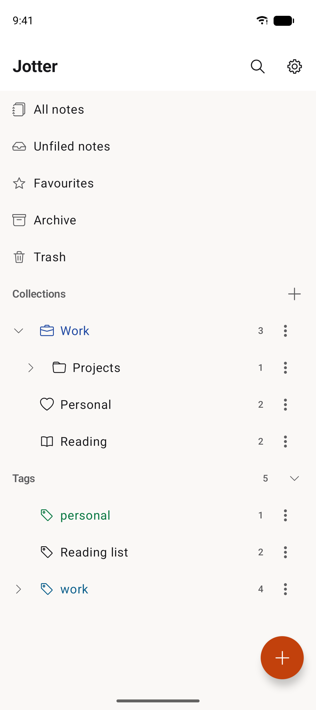
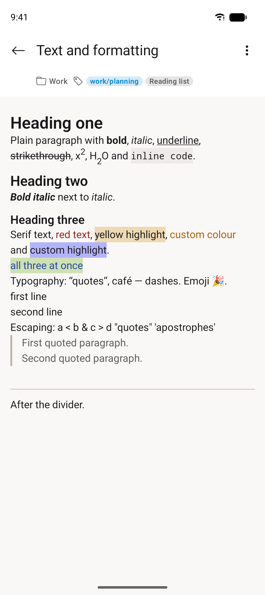
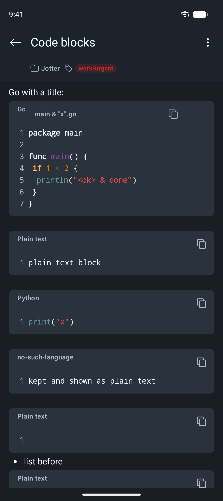

# Jotter for Android

Jotter for Android is the phone client of [Jotter](https://github.com/nir0k/Jotter), a simple note manager whose notes are stored as ordinary HTML files that stay readable without the application. It opens the same libraries as Jotter for the desktop, edits notes with the same rich text vocabulary and synchronises with them through your own SFTP server, so a library moves between a phone and a computer without conversion.

  
  
  

## Features

- A native rich text editor with headings, lists and checklists, tables, images, attachments, code blocks with syntax highlighting, note links, Markdown shortcuts while typing and Markdown on paste.
- Nested collections, nested tags with colours, favourites, an archive and a trash.
- Full-text search that finds every form of a word in English and Russian, with filters by collection, tag and date.
- Rules that file notes into collections by their tags.
- Quick capture from an app shortcut, a Quick Settings tile and the system share sheet; Markdown and plain text files open in Jotter as new notes.
- Export to PDF, HTML and JPG.
- Synchronisation of a library through a folder on your own SFTP server, with three-way merges and conflict copies, in the background or on request.
- Light and dark themes, several palettes, English and Russian interface.

## Install

Download `jotter-android-<version>.apk` from the [latest release](https://github.com/nir0k/jotter-android/releases/latest) and open it on the phone; Android asks to allow installing from the application that opened it. A newer release is installed the same way over the older one.

Jotter for Android needs Android 16 or newer. It uses no Google Play services.

## Privacy

- The library lives in the application's private storage and leaves the phone only through synchronisation with the SFTP server you choose. Jotter has no account, no analytics and no other network connections.
- Passwords, private keys and passphrases are encrypted with a key of the Android Keystore. The application's data is excluded from Android's cloud backup and device-to-device transfer: the sync storage is the second copy of a library.
- Permissions: Internet for synchronisation; notifications for sync problems found in the background, asked when you connect a sync storage; location only when you switch on geotags for new notes; a foreground service for long sync runs. Photos come through the system camera and files through the system's pickers, so there is no camera or storage permission.

## Library format

A library is a folder of HTML notes and a few JSON files, shared with Jotter for the desktop. The [Jotter specification](https://github.com/nir0k/Jotter/blob/main/docs/spec.md) specifies the library format and synchronisation; [docs/spec.md](docs/spec.md) describes how the Android client behaves.

## Building and contributing

[docs/development.md](docs/development.md) describes the requirements, building, checks, the SFTP test stand, translations and releases. [CONTRIBUTING.md](CONTRIBUTING.md) explains how to report problems and propose changes, and [SECURITY.md](SECURITY.md) how to report a vulnerability.

## License

Jotter for Android is licensed under the [Apache License 2.0](LICENSE).

The application includes [Bootstrap Icons](https://icons.getbootstrap.com/) (MIT), the syntax definitions and themes of [KDE SyntaxHighlighting](https://invent.kde.org/frameworks/syntax-highlighting) (each file under the licence it names: MIT, LGPL, Apache 2.0, GPL or BSD, WTFPL), the [Snowball](https://snowballstem.org/) stemmers (BSD 3-Clause), [sshj](https://github.com/hierynomus/sshj) (Apache 2.0), [Bouncy Castle](https://www.bouncycastle.org/) (MIT), [SLF4J](https://www.slf4j.org/) (MIT), [commonmark-java](https://github.com/commonmark/commonmark-java) (BSD 2-Clause), [autolink-java](https://github.com/robinst/autolink-java) (MIT), [Protocol Buffers](https://protobuf.dev/) (BSD 3-Clause) and AndroidX, Jetpack Compose and the Kotlin libraries (Apache 2.0). Their licence texts are in [app/src/main/assets/licenses/](app/src/main/assets/licenses/) and in Settings → General → About → Licences.
